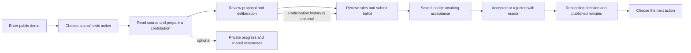

> **Planning baseline, October 29, 2026.** This document records the source-pinned design before implementation. Statements about a documentation-only checkout and unimplemented behavior describe that planning snapshot. See [the current README](../../README.md) for the implemented demo, commands, and current limitations. Example governance remains a labeled demo fixture, not approved production policy.

# Zaction: action to a group decision

Status: screen-flow proposal for the first usable public-demo increment. This document implements no screens. It follows the exact [Spec/source pin](sources.md#specification-pin) and the [implementation plan](implementation-plan.md).

## One coherent scenario

A member joins a public demo and chooses **“Help prepare a free school-budget reading circle.”** They review a clearly labeled demonstration agenda, contribute one question or accessibility correction, review a $0 proposal, take part in a group vote, and see the decision, minutes, and next available action. Their private progress acknowledges participation. A shared milestone describes group progress toward a useful outcome. Neither changes their voting weight.

The demo uses synthetic people and agenda material. The proposal is a plan for a discussion, with a tentative venue and date. No room is booked, message sent externally, payment collected, or real-world attendance inferred. Real official sources replace the demonstration source card only after a jurisdiction is selected and reviewed.

The ballot is also directly reachable from the group's proposal list. Reading/completing the action is encouraged and never a prerequisite for voting. “Participation” is broader than posting: reading, a short question, a correction, an abstention where permitted, and completing a useful task can each be acknowledged without ranking people (§3.8 p.11).

## Screen-by-screen contract

| Screen | What the member sees | Action and resulting record | Critical boundaries |
|---|---|---|---|
| 1. Welcome / public demo | Zaction's purpose, what is public, local identity explanation, optional PWA install education | Enter demo; create/reuse device-local key and a pseudonym | No email/phone; never imply a new device key proves a unique human; first-visit offline cannot fetch an uncached app |
| 2. Action home | One finite group objective, one small next action, deliberation/broadcast labels, link to proposals | Open the reading task or go straight to an open proposal | No fabricated crowd/activity count; no mandatory streak, score, or reward gate |
| 3. Source and contribution | Demo source notice; source URL/date/jurisdiction slots; short agenda; text alternative; “Ask a question” / “Suggest a correction” | Save a private draft, then explicitly publish to the public deliberation | “Saved on this device” differs from “Shared with the group”; location/photo unnecessary for this task; a popular contribution is not verified evidence |
| 4. Personal and shared progress | Optional private checklist; shared objective state such as “Questions gathered → Decision recorded → Next action completed” | Confirm/undo self-reported private progress; inspect the milestone's stated criteria | Exact criteria/visual treatment need review; self-report is labeled; do not disclose someone's ballot choice or name inactive members |
| 5. Proposal and deliberation | Goal, beneficiaries, $0 budget, tentative date/venue, source links, proposal revision, published rules, rotating facilitator role, separate discussion and summary | Contribute a short position/correction; inspect human-reviewed, correctable summary; open ballot | Facilitator is a temporary role; no popularity vote installing a leader; summary approval is not proposal adoption |
| 6. Ballot review | Exact proposal/rule/eligibility snapshot; choices; quorum/closing rules; public-record notice; submission state | Explicitly submit a ballot intent naming these revisions | Equal weight per eligible demo membership; no contribution score factor; drafts/reactions are not ballots; no auto-cast or agent-cast ballot |
| 7. Submission / reconciliation | Saved locally → queued → accepted/rejected; receipt and reason; last successful sync | Retry the same operation ID; review any version/deadline conflict | No “counted” confirmation before acceptance; cached local tally is provisional; reconnect does not guarantee acceptance |
| 8. Decision, minutes, next action | Awaiting outcome / adopted / not adopted / no quorum / disputed; rules and accepted ballot provenance; human-published minutes; next tasks | Inspect outcome; correct minutes through a visible correction path; voluntarily take the next task | An adopted plan is not a completed event; public participation attribution/retention needs explicit policy; no funding step in Phase 1 |

## Example-only demo governance

This configuration makes a demonstration testable. It is **not approved production governance** and is not prescribed by the PDF. Review it before implementation. The live-group questions are listed in the implementation plan.

| Field | Proposed fixture value |
|---|---|
| Rule and membership snapshots | `DEMO-RULES-v1`; three explicitly seeded synthetic eligible members |
| Proposal | A frozen revision of a $0 reading-circle proposal, with tentative logistics |
| Choices and weight | Approve / oppose / abstain; equal weight of one per eligible demo membership |
| Quorum and outcome | At least two accepted member ballots; approve must strictly exceed oppose; abstentions count for quorum; a tie is not adopted |
| Submission window | Fixture closing time shown with timezone; a selected demo acceptance process must receipt the ballot before close; client timestamps do not override close |
| Retries and duplicates | Reusing the operation ID returns the same result; another device/operation cannot grant a member an additional ballot |
| Revision and ballot changes | New proposal revision requires a new explicit ballot; no silent carryover; the fixture uses one accepted ballot per member and explains that it is final before submission |
| Closure and disputes | The demo's configured acceptance/closure authority and receipts are visible; conflicting results remain disputed until reconciled, never silently replaced |
| Visibility | Public demo uses synthetic pseudonyms and visible participation receipts; real-member attribution, ballot-choice visibility, and retention remain unresolved |

Happy-path example: all three seeded members participate; two approve and one abstains; the configured demo process accepts their ballots before close and produces an adopted outcome with minutes. A second scenario deliberately misses quorum. This shows distinct outcomes without claiming production resistance to duplicate humans, clock manipulation, censorship, or partitions.

## Persistence and network state model

`editing → durable local draft → queued submission → accepted/rejected → reconciled outcome`

For a draft, “durable” means the actual IndexedDB write completed. For a shared item, “accepted” means a receipt under the selected protocol/rules was obtained and persisted. For a final outcome, all stated eligibility, close, quorum, and reconciliation requirements must be satisfied. CRDT convergence and a local timer alone do not establish those facts.

| State | Copy and available behavior | State transition / protection |
|---|---|---|
| Empty group/task/proposal | “No proposal yet. Explore the demo or draft the first proposal.” | Show a real next action; never seed unlabeled votes or public activity |
| Local loading | “Opening saved work…”; retain the composer if already visible | Do not flash “no contributions” before reading storage; show loading separately from empty |
| Peer loading | Cached view plus “Checking for group updates”; source date and last sync | Local reading/editing remains available; prevent repeated submission while an intent is being persisted |
| Offline with cached content | “Offline — showing saved material from [date]”; edit/save locally | Persist drafts/progress; mark pending shared work; reload must retain them |
| Offline without requested material | Once the shell is available: “This material is not saved on this device”; offer cached alternatives/retry | Do not invent an official source or current tally; a wholly uncached first visit receives the browser's offline response because no app shell can render yet |
| Offline ballot intent | “Saved on this device — awaiting group acceptance” | Accepted totals stay unchanged; show the deadline risk and the pending choice |
| Write/quota failure | “Could not save on this device”; preserve visible input; retry or copy the draft | Never display saved/queued if storage failed; explain that closing the page may lose unsaved text |
| Fetch/relay failure | “Group updates unavailable”; show last sync and retry | Keep local work; separate a successful network connection from accepted content |
| Foreground reconnect | “Checking proposal and rules, then sending pending items” | Revalidate eligibility, revision, and deadline; submit stable IDs; persist each acceptance/rejection receipt |
| Closed or revised while offline | “Your saved vote was not accepted: [specific rule/version/deadline reason]” | Retain the local intent; offer the current proposal; never silently transfer the vote |
| Conflicting/corrupt record | “This item needs review”; explain affected record and available retry | Keep valid local drafts; do not overwrite or finalize conflicting outcomes; no key/export details in logs |
| Awaiting closure / partition | “Outcome pending — some receipts are not reconciled” | Provisional totals stay labeled; disable irreversible follow-on claims |
| No quorum / not adopted | Explain which published rule applies; link minutes and an option to prepare a revised proposal | Do not turn participation progress into a claim of approval or a completed event |
| Reconciled adoption | “Plan adopted”; show governing versions, provenance, minutes, and uncompleted next tasks | Human confirmation is still required for outside commitments; task completion is a separate later event |
| Agent loading/error/unsupported | “Draft assistant unavailable”; preserve manual authoring | No fabricated summary, hidden cloud inference, or model-download claim; no automatic sends |

Use foreground open/focus and deliberate retries as the baseline reconnect path. Optional browser background facilities may improve it, but the flow must complete when background sync is unavailable (§4.6 pp.13–14). Never assume an “online” event means the required peer is reachable. Handle service-worker updates without discarding open drafts.

## Acceptance scenarios

These are proposed future application tests, not results of the environment probe. Use isolated browser contexts and a controllable relay/clock fixture; record the actual pinned app/library versions when implemented.

| ID | Given / action | Required evidence |
|---|---|---|
| A01 | Fresh browser enters public demo and later installs/reloads | Same local identity and saved data; no phone/email requested; clear public-demo notice |
| A02 | Empty fixture and slow storage/peer reads | Loading and empty are distinct; no fabricated member, contribution, or vote count |
| A03 | Member writes a question, disconnects, reloads, reconnects | Exact draft retained; explicit publish; one shared contribution after retry |
| A04 | IndexedDB write is denied or quota error occurs | Input remains recoverable; no saved/queued confirmation or accepted operation is emitted |
| A05 | Member has no completed progress items and opens ballot | Same eligibility and weight as an active member; no posting, sharing, payment, or streak gate |
| A06 | Two members choose different ballot options | Same progress acknowledgement for participating; no disclosure of vote choice through a progress event |
| A07 | Submit while offline; replay same operation after two reconnects | Pending label first; no premature tally; exactly one acceptance receipt and one effective member ballot |
| A08 | Proposal changes or closes before pending submission reaches the selected acceptance process | Explicit rejection under fixture policy; original intent preserved; no silent recast on the new revision |
| A09 | Two devices submit for the same eligible demo membership | No second effective ballot; the documented duplicate rule and receipt explain the result |
| A10 | All demo ballots accepted versus missing-quorum fixture | Adopted and no-quorum outcomes are distinct and reproducible from the pinned rules and receipts |
| A11 | Partition produces inconsistent partial tallies | Pending/disputed state persists; no final-result badge from a local timer or incomplete peer view |
| A12 | Summary or minutes contain an error | Human correction path preserves visible history; summary edits cannot alter a recorded ballot silently |
| A13 | A member completes reading task but no event has happened | Personal progress can show self-reported reading; group view cannot claim event completion or verified public turnout |
| A14 | Keyboard and screen reader traverse contribution, rule notice, ballot, and error states | Named inputs, semantic landmarks, focus recovery, announced status/errors; map/media never the only way to participate |
| A15 | Agent disabled or unsupported GPU | Manual loop completes; no agent result invented; no model downloaded without explicit opt-in |
| A16 | Official-election link opened in the later Learn branch | Source/date and destination visible; no assertion of registration/voting completion; no ballot-proof collection |

No production voting launch should rely only on these fixtures. Real membership eligibility, privacy/retention, relay operation, and closure/reconciliation require the explicit decisions and feasibility evidence in the plan.
